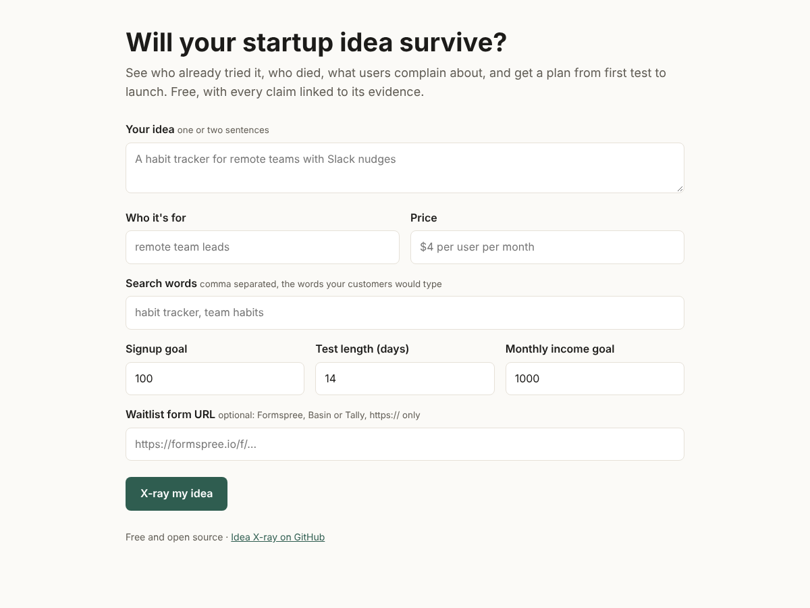
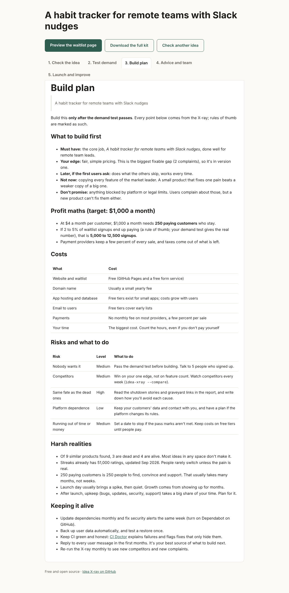
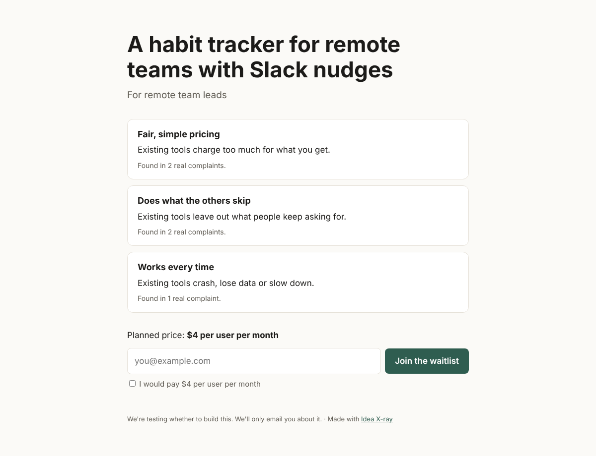

# 🩻 Idea X-ray

**Will your startup idea survive? Find out who already tried it, who's still alive, who died and what their users complain about, then go from first test to launch with a plan built on that evidence.**

Most startups fail because nobody needed what they built. In [CB Insights' study](https://www.launchrock.com/library/expert-advice/why-do-startups-fail) of 101 failed startups, 42% gave "no market need" as a reason. Other tools stop at a score. Idea X-ray is free, open source, links every claim to its evidence, and walks you through all five stages:

| Stage | What you get |
|---|---|
| **1. Check the idea** | Similar products from Hacker News, GitHub, the App Store, Reddit and Y Combinator, each marked 🟢 live, 🟡 prototype or 🪦 dead, with evidence. Links to the startup graveyards (Loot Drop, Startups.RIP, Failory). A durability score out of 100 and a devil's advocate. |
| **2. Find the gaps** | Real user complaints grouped into gaps (price, reliability, missing features…), each marked fixable or not, with a profit angle. |
| **3. Test demand** | A ready-to-publish waitlist page that promises only what the evidence shows, plus a test plan with a pass mark you set *before* anyone sees it. |
| **4. Plan and get help** | What to build first, profit maths from your price, costs, risks with what to do, harsh realities, upkeep. Ready-to-post asks for expert reviews and co-builders. |
| **5. Launch and improve** | A launch checklist, a weekly feedback loop, and a competitor watch that tells you when someone new appears or a rival dies. |

See a [sample kit](examples/kit/) built from test data.



## Try it in your browser

```bash
pip install git+https://github.com/amarasuchitra/idea-xray
idea-xray serve
```

Open http://localhost:8000, describe your idea, and get every stage in tabs. Preview the waitlist page, or download the whole kit as a zip.

<details><summary>What a result looks like (made from test data)</summary>




</details>

To host it for others, use the included `Dockerfile` on any Docker host. Set AI keys as the host's secrets.

## Or use the command line

```bash
pip install git+https://github.com/amarasuchitra/idea-xray
idea-xray "A habit tracker for remote teams with Slack nudges" \
  --customer "remote team leads" --price "\$4 per user per month" \
  --keyword "habit tracker" --keyword "team habits" --out report.md
```

Or put the idea in a file and run `idea-xray --file idea.yaml`:

```yaml
pitch: A habit tracker for remote teams with Slack nudges
customer: remote team leads
price: $4 per user per month
keywords: [habit tracker, team habits]
```

Good keywords matter most. Use the words your customers would type, not your product name.

Add `--kit my-idea` to write every stage as files:

```
my-idea/
  1-xray-report.md           stage 1 and 2: what exists, what died, the gaps, the score
  2-demand-test/index.html   stage 3: the waitlist page
  2-demand-test/TEST-PLAN.md stage 3: the pass mark and dates
  3-build-plan.md            stage 4: scope, profit maths, costs, risks, harsh realities
  4-ask-for-help.md          stage 4: posts asking for reviews and co-builders
  5-launch.md                stage 5: launch checklist and feedback loop
  xray.json                  stage 5: a snapshot to compare with next time
```

`--target 2000` sets the monthly income the build plan works towards.

## Test real demand (stage 3)

A score is evidence, not proof. Only real people signing up can prove an idea. Add `--page` and Idea X-ray also writes a one-page waitlist site and a test plan:

```bash
idea-xray "A habit tracker for remote teams with Slack nudges" --keyword "habit tracker" \
  --customer "remote team leads" --price "\$4 per user per month" \
  --page demand-test --form https://formspree.io/f/your-form-id --goal 100 --days 14
```

- **`index.html`** promises only what the X-ray found: each fixable gap becomes one line, with how many real complaints back it. It has a waitlist form and an "I would pay" tick box, which is a stronger signal than an email. It works on phones and in dark mode, with no other files.
- **`TEST-PLAN.md`** fixes the pass mark and dates *before* anyone sees the page, and says what to do if you hit it or miss it.

Collect emails with any free form service (Formspree, Basin, Tally) and host the page free on GitHub Pages. See the [sample page](examples/kit/2-demand-test/index.html) and [plan](examples/kit/2-demand-test/TEST-PLAN.md).

## Advice and a team (stage 4)

Post your X-ray in [Discussions](https://github.com/amarasuchitra/idea-xray/discussions) using the **Idea review** or **Looking for team** form. Founders review each other's evidence, and builders find projects that already have proof of demand.

## Watch your competitors (stage 5)

```bash
idea-xray --file idea.yaml --save xray.json          # first time
idea-xray --file idea.yaml --compare xray.json       # later: what changed?
```

It lists new competitors, ones that died, and complaint themes that grew. `5-launch.md` includes a GitHub Actions workflow that runs this every Monday and opens an issue when something changed.

## Free by default

All five sources are free and need no key. A `GITHUB_TOKEN` raises GitHub's search limit.

The devil's advocate uses built-in rules unless you add a key for any of these free tiers. When one runs out for the day, the next one is tried:

| Provider | Env variable | Note |
|---|---|---|
| GitHub Models | `GITHUB_TOKEN` | Free with limits. In Actions, give the job `models: read` |
| Groq | `GROQ_API_KEY` | Free tier, very fast |
| Cerebras | `CEREBRAS_API_KEY` | Free tier |
| Google AI Studio | `GEMINI_API_KEY` | Free tier; prompts may be used for training outside the EU/UK |
| OpenRouter | `OPENROUTER_API_KEY` | Free models with a daily limit |

Free limits and model names change often. Override a model with `IDEA_XRAY_<PROVIDER>_MODEL`, for example `IDEA_XRAY_GROQ_MODEL`. Use your own accounts: shared or leaked keys break the providers' terms and get banned. Use `--no-ai` to force the rules.

## Startup graveyards

| Graveyard | What it has | How Idea X-ray uses it |
|---|---|---|
| YC directory (via [yc-oss](https://github.com/yc-oss/api)) | Every launched YC company, with Active, Inactive, Acquired or Public | Searched directly. Inactive companies count as dead competitors |
| [Startups.RIP](https://startups.rip) | Post-mortems and rebuild plans for 1,700+ inactive YC companies | Linked search in the report |
| [Loot Drop](https://www.loot-drop.io) | 1,200+ dead startups with money burned, cause of death and rebuild plans | Linked search in the report |
| [Failory](https://www.failory.com/cemetery) | Founder interviews and a startup cemetery | Linked search in the report |

Loot Drop, Startups.RIP and Failory have no public API or reuse license, so Idea X-ray links to them instead of copying their pages. Much of their writing is AI-assisted, so check facts before relying on them.

## More platforms with Agent-Reach (optional)

[Agent-Reach](https://github.com/Panniantong/Agent-Reach) can search X/Twitter, LinkedIn, YouTube and logged-in Reddit, which have no free API. Install it on your own computer and add `--reach`:

```bash
pip install agent-reach && agent-reach setup
idea-xray "..." --keyword "habit tracker" --reach twitter --reach linkedin --reach youtube
```

Their posts become complaints and shutdown stories, like the other sources. A channel that needs a login is skipped and listed in the report's limits. Use a secondary account: logged-in scraping can break a site's terms and get the account blocked, so never run `--reach` in shared CI.

## Be honest with yourself

- **The score is not a prediction.** It shows how strong the evidence is today. Only real people signing up or paying can prove an idea.
- **"Nothing found" is not good news by default.** It can mean a fresh chance, or that nobody wants this.
- **A crowded market proves demand.** A graveyard full of similar products is a warning, and its shutdown posts are free lessons.
- **Search is not the whole world.** It misses products outside these sources, and it can't see private revenue. Check the links yourself.
- **Complaint text is written by strangers.** It is treated as data. The AI is told never to follow instructions inside it.

## How it works

```
idea + keywords
   ├─ sources/hackernews.py  launches (Show HN), shutdown posts, complaints in comments
   ├─ sources/github.py      open-source attempts: stars, last push, archived
   ├─ sources/appstore.py    apps: ratings, last version date
   ├─ sources/reddit.py      complaints, "alternative to" posts, shutdown posts
   ├─ sources/yc.py          YC companies: active, acquired or Inactive (dead)
   └─ sources/agentreach.py  optional: X/Twitter, LinkedIn, YouTube through Agent-Reach
liveness.py   live / prototype / graveyard rules (18 months without an update = abandoned)
gaps.py       complaints → themed gaps, fixable or not, profit angle
score.py      durability score parts + rule-based devil's advocate
llm.py        optional AI devil's advocate with free-provider fallback
report.py     the Markdown report
demand.py     stage 3: waitlist page and test plan
plan.py       stage 4: scope, profit maths, costs, risks, harsh realities
community.py  stage 4: asks for reviews and co-builders, and where to post them
launch.py     stage 5: launch checklist and the competitor-watch workflow
watch.py      stage 5: snapshots and what changed
kit.py        every stage as files, or one zip
web.py        the browser app (idea-xray serve)
```

A source that fails is skipped and listed under "Limits of this report", so one outage never stops the X-ray.

## Development

```bash
pip install -e ".[dev]"
ruff check . && ruff format --check . && pytest -q
```

Tests run against recorded API responses in `tests/fixtures`, so they need no network.

## Related

[CI Doctor](https://github.com/amarasuchitra/ci-doctor) keeps your build honest after launch: it explains CI failures and flags "fixes" that only hide them.

## License

MIT
